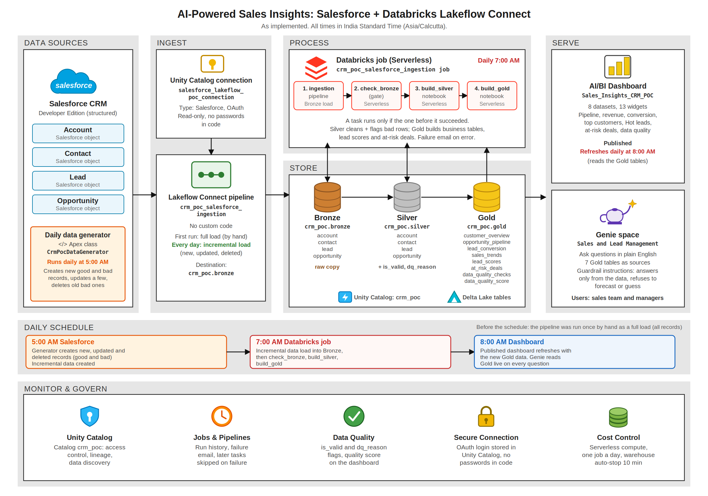
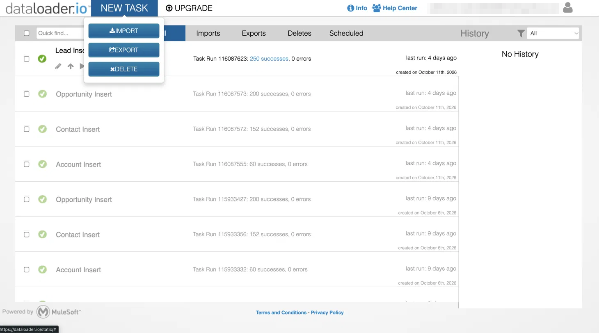
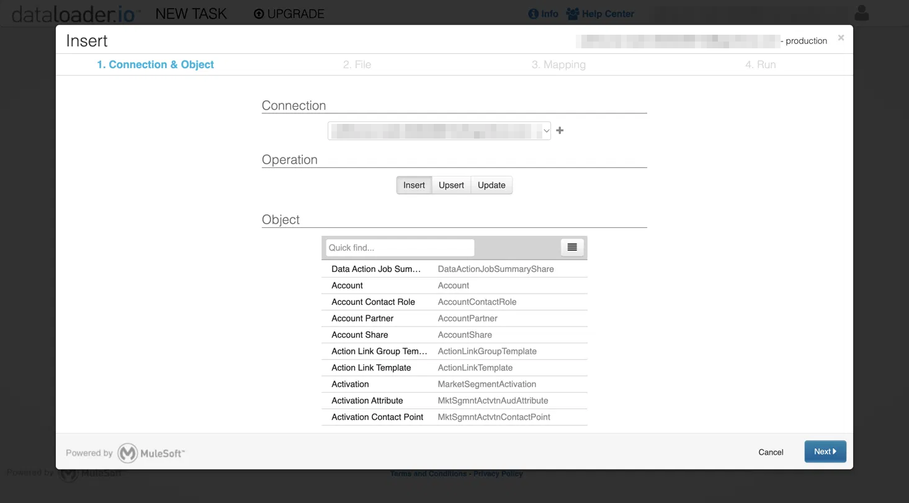
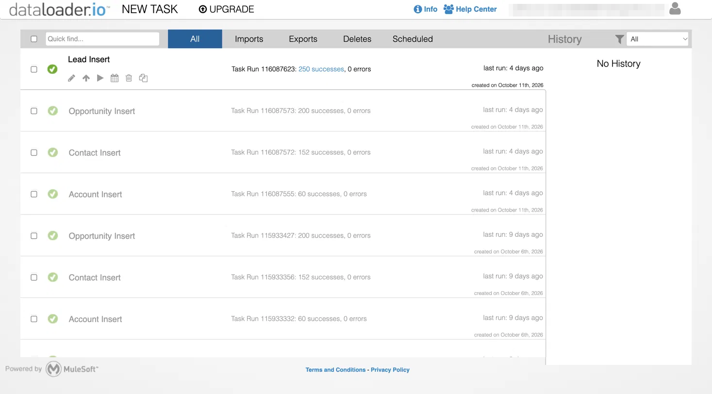
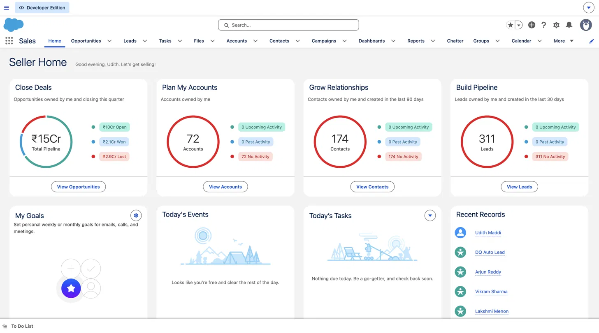

# AI-Powered Sales Insights using Salesforce and Databricks Lakeflow Connect
**End-to-end POC guide: Steps 1 to 10 (explanations only, code is in separate files)**

Catalog: `crm_poc` · Connection: `salesforce_lakeflow_poc_connection` · Pipeline: `crm_poc_salesforce_ingestion` · Currency: INR

---

## Problem statement

The company keeps customer and sales data (Accounts, Contacts, Leads, Opportunities) in Salesforce. Today:

- Moving this data into Databricks needs custom programs that take time to build and are hard to maintain.
- The sales team cannot easily see which leads to focus on or which deals are at risk.
- Nobody checks the data for mistakes, so reports are not fully trusted.
- Business users depend on technical people for every new report or question.

---

## Prerequisites

| Need | Details |
| --- | --- |
| Salesforce | A free Developer Edition org, with a user who can open the Developer Console and schedule Apex. Set the user's time zone to India Standard Time. |
| Databricks | A workspace with Unity Catalog and serverless compute, plus a serverless SQL warehouse for the dashboard and Genie |
| Databricks permissions | Create a catalog (or an admin creates `crm_poc` for you), `CREATE CONNECTION`, and permission to create pipelines, jobs, dashboards and Genie spaces |
| Optional | AI Functions enabled (only for the optional `ai_gen` cell in Step 6) and dataloader.io (to load the sample CSV files in Step 1) |
| Project files | The sample CSV files and the code files listed under "Project files" |

---

## Architecture



**How the data flows, in words**
1. Salesforce holds Accounts, Contacts, Leads and Opportunities. Every day at 5:00 AM the generator adds new, updated and deleted records, some of them deliberately bad.
2. The Unity Catalog connection stores the Salesforce OAuth login. The Lakeflow Connect pipeline uses it to copy the four objects into Bronze, fully the first time and incrementally after that.
3. The daily job (7:00 AM) runs the pipeline, then the Bronze gate, then Silver, then Gold. Each task runs only if the one before it succeeded.
4. Silver cleans the data and flags bad rows with a reason. Gold builds the business tables from the valid rows only.
5. The AI/BI dashboard (refreshed at 8:00 AM) and the Genie space both read the Gold tables.
6. Unity Catalog governs access, the job sends a failure email, and the data quality score shows how clean each object is.

| Layer | Schema | Purpose |
| --- | --- | --- |
| Bronze | `crm_poc.bronze` | Raw copy. We can always rebuild from it |
| Silver | `crm_poc.silver` | Clean, typed, quality-checked. Bad rows flagged, not deleted |
| Gold | `crm_poc.gold` | Business-ready tables used by the dashboard and Genie |

---

## Implementation flow

| Step | What | Where | Result |
| --- | --- | --- | --- |
| 1 | Salesforce org and sample data | Salesforce | Accounts, Contacts, Leads and Opportunities in Salesforce |
| 2 | Catalog setup (`crm_poc` + bronze, silver, gold) | Databricks | Catalog `crm_poc` with schemas `bronze`, `silver`, `gold` |
| 3 | Connection `salesforce_lakeflow_poc_connection` | Databricks | Secure Unity Catalog connection to Salesforce |
| 4 | Bronze: ingestion pipeline, raw data | Databricks | Raw tables `account`, `contact`, `lead`, `opportunity` in `bronze` |
| 5 | Silver: clean data + quality checks | Databricks | Clean tables with `is_valid` / `dq_reason` flags and a data quality score |
| 6 | Gold: business tables + lead scoring + at-risk deals | Databricks | Business tables, Hot/Warm/Cold lead scores, at-risk deals |
| 7 | AI/BI dashboard | Databricks | Published sales dashboard (8 datasets, 13 widgets) |
| 8 | Genie space | Databricks | Plain-English questions answered from Gold tables, with guardrails |
| 9 | Daily automation: Salesforce data generator (5:00 AM IST) and Databricks job (7:00 AM IST) | Salesforce + Databricks | New data every day, loaded, cleaned and published automatically |
| 10 | End-to-end tests and demo | Databricks | Evidence that every layer works |

**Run the steps in order.** Each step needs the one before it.

**How to import a notebook:** Workspace → your `crm_poc` folder → ⋮ → **Import** → choose the `.sql` file → attach **Serverless** compute → **Run all**. The code for each step is in its own file, named at the top of that step.

---

## Daily timeline (India Standard Time)

| When | Where | What happens | Load type |
| --- | --- | --- | --- |
| Earlier, once | Databricks | The pipeline was run by hand and copied every record | Full load |
| Every day, 5:00 AM | Salesforce | The generator creates new records (good and bad), updates a few, and deletes old bad ones. Nothing moves to Databricks yet. | Incremental data created |
| Every day, 7:00 AM | Databricks job | The pipeline loads only the new, updated and deleted records into the Bronze tables | Incremental data load into Bronze |
| After Bronze, same job | Databricks job | `check_bronze`, then `build_silver`, then `build_gold`. If one task fails, the next ones are skipped and the old Gold data stays. | Rebuilt fully |
| Every day, 8:00 AM | Dashboard | The published dashboard refreshes on its own schedule, so its numbers update without anyone clicking Refresh | n/a |
| Morning | Dashboard and Genie | Show the new data, new at-risk deals, new Hot leads and the quality score | n/a |

The two hours between 5:00 and 7:00 AM are only a safety gap. The generator finishes in seconds.

---

## Solution / Output

- **Sales dashboard:** pipeline by stage, monthly revenue, lead conversion, top customers, Hot leads, at-risk deals and data quality.
- **Hot / Warm / Cold lead list:** sales knows who to call first.
- **At-risk deals list:** managers act before a deal is lost.
- **Data quality score:** everyone knows the numbers can be trusted, and bad records are listed with the reason.
- **Genie:** ask questions like "Which lead source converts best?" in plain English. It answers only from the Gold tables and says "I don't have that data" instead of guessing.
- **Automatic daily refresh:** Salesforce changes at 5:00 AM, the Databricks job loads and rebuilds everything at 7:00 AM, with no manual upload.
- **Reusable pattern:** the same design works for other sources such as ServiceNow (only the connection and table names change).

---

## Naming reference

Use these exact names everywhere (code, job, dashboard, Genie).

| Area | Name | Notes |
| --- | --- | --- |
| Catalog | `crm_poc` | Unity Catalog |
| Schemas | `crm_poc.bronze`, `crm_poc.silver`, `crm_poc.gold` | One per data layer |
| Bronze tables | `account`, `contact`, `lead`, `opportunity` | Salesforce API column names (`Id`, `StageName`, `CloseDate`) |
| Silver tables | `account`, `contact`, `lead`, `opportunity` | Clear snake_case names, plus `is_valid` and `dq_reason` |
| Gold tables | `customer_overview`, `opportunity_pipeline`, `lead_conversion`, `sales_trends`, `lead_scores`, `at_risk_deals`, `data_quality_checks`, `data_quality_score` | Also optional `at_risk_deal_actions` (AI cell) |
| Connection | `salesforce_lakeflow_poc_connection` | Type Salesforce, OAuth, Is sandbox false |
| Ingestion pipeline | `crm_poc_salesforce_ingestion` | Streaming tables `account`, `contact`, `lead`, `opportunity` in `crm_poc.bronze` |
| Databricks job | `crm_poc_salesforce_ingestion job` | Created by the pipeline wizard; daily 7:00 AM, Asia/Calcutta |
| Job tasks | `crm_poc_salesforce_ingestion`, `check_bronze`, `build_silver`, `build_gold` | In this order, each depends on the one before |
| Notebooks (workspace and repository) | `03_check_bronze_gate`, `04_silver_cleaning_and_quality`, `05_gold_tables_and_ai_scoring` | Same names in the workspace and in `databricks/sql/`; the numbers are the run order |
| Salesforce class | `CrmPocDataGenerator` | Apex class |
| Salesforce scheduled job | `CRM POC Daily Data Generator` | Daily 5:00 AM, user time zone India Standard Time |
| Test record names | `DQ Auto ...` and Site / Department `AUTO-GEN-BAD` | Marks the generator's bad records so they can be cleaned up |
| Dashboard | `Sales_Insights_CRM_POC` | Published; refresh daily 8:00 AM, Asia/Calcutta |
| Genie space | `Sales and Lead Management` | Rename it to `Sales Insights Genie` if you prefer |
| Salesforce owners | your user (our records), `OEPIC` (Salesforce sample records) | Used to tell the two sets apart |

---

## Project files

```
.
├── README.md
├── data/
│   ├── Accounts.csv
│   ├── Contacts.csv
│   ├── Leads.csv
│   └── Opportunities.csv
├── salesforce/
│   ├── CrmPocDataGenerator.cls
│   └── schedule_data_generator.apex
├── databricks/
│   ├── sql/
│   │   ├── 01_catalog_setup.sql
│   │   ├── 02_check_connection.sql
│   │   ├── 03_check_bronze_gate.sql
│   │   ├── 04_silver_cleaning_and_quality.sql
│   │   └── 05_gold_tables_and_ai_scoring.sql
│   ├── pipeline/
│   │   └── bronze_ingestion_pipeline.json
│   └── job/
│       └── daily_job_definition.json
├── dashboard/
│   ├── Sales_Insights_CRM_POC.lvdash.json
│   ├── Sales_Insights_CRM_POC_DASHBOARD.pdf
│   └── dashboard_datasets.sql
├── genie/
│   ├── genie_general_instructions.txt
│   └── genie_space_setup.md
├── screenshots/
│   ├── 01_salesforce_seller_home.png
│   ├── 02_dataloader_new_task_menu.png
│   ├── 03_dataloader_insert_connection_object.png
│   └── 04_dataloader_task_results.png
└── docs/
    ├── Overview.md
    ├── architecture_diagram.png
    └── architecture_diagram.svg
```

The numbers on the SQL notebooks (01 to 05) are the order in which they are run. They are not the step numbers of this document.

| File | Used in step | What it is |
| --- | --- | --- |
| `data/Accounts.csv`, `Contacts.csv`, `Leads.csv`, `Opportunities.csv` | 1 | Sample data loaded into Salesforce (60 / 152 / 250 / 200) |
| `databricks/sql/01_catalog_setup.sql` | 2 | Creates the catalog and the three schemas |
| `databricks/sql/02_check_connection.sql` | 3 | Checks the Salesforce connection |
| `databricks/pipeline/bronze_ingestion_pipeline.json` | 4 | Optional: the ingestion pipeline as code |
| `databricks/sql/03_check_bronze_gate.sql` | 4 and 9 | Lists the Bronze tables and row counts, then the gate that fails if a Bronze table is empty. It is the job task `check_bronze`. |
| `databricks/sql/04_silver_cleaning_and_quality.sql` | 5 and 9 | Silver tables and quality checks. It is the job task `build_silver`. |
| `databricks/sql/05_gold_tables_and_ai_scoring.sql` | 6 and 9 | Gold tables, lead scores, at-risk deals. It is the job task `build_gold`. |
| `dashboard/dashboard_datasets.sql` | 7 | The eight dashboard queries |
| `dashboard/Sales_Insights_CRM_POC.lvdash.json` | 7 | Importable dashboard (8 datasets, 13 widgets) |
| `dashboard/Sales_Insights_CRM_POC_DASHBOARD.pdf` | 7 | PDF export of the published dashboard (17 Oct 2026) |
| `screenshots/01_` to `04_*.png` | 1 | Salesforce Seller Home and dataloader.io screenshots (login name hidden) |
| `genie/genie_general_instructions.txt` | 8 | Full Genie instructions to paste |
| `genie/genie_space_setup.md` | 8 | Genie sources, sample questions, example SQL and tests |
| `salesforce/CrmPocDataGenerator.cls`, `schedule_data_generator.apex` | 9 | Daily data generator and its schedule lines |
| `databricks/job/daily_job_definition.json` | 9 | Optional: the job as code (the job is normally built in the UI) |
| `docs/architecture_diagram.png`, `architecture_diagram.svg` | all | The architecture picture |
| `docs/Overview.md` | all | This document |

---

## Basics first: the words you will see

| Term | Simple meaning | In this project |
| --- | --- | --- |
| Unity Catalog | Where all data, folders and permissions are managed | Holds everything for this POC |
| Catalog | Main folder for one project | `crm_poc` |
| Schema | Sub-folder inside the catalog | `bronze`, `silver`, `gold` |
| Table | Rows and columns of data | `bronze.opportunity`, `gold.lead_scores` |
| Connection | A saved, secure login to an outside system | `salesforce_lakeflow_poc_connection` |
| Lakeflow Connect | Databricks' ready-made connector for apps like Salesforce | Copies 4 objects into Bronze |
| Pipeline | A process that moves data from one place to another | `crm_poc_salesforce_ingestion` |
| Notebook | A page of code cells you run one by one | The `.sql` files |
| Job | A schedule that runs pipelines and notebooks in order | `crm_poc_salesforce_ingestion job` (daily 7:00 AM IST) |
| Apex class | Code that runs inside Salesforce | `CrmPocDataGenerator` (daily 5:00 AM IST) |
| AI/BI Dashboard | Charts and tables on top of tables | Sales Insights dashboard |
| Genie | Ask questions in plain English, get answers from tables | "Which lead source converts best?" |

**Medallion architecture:** data gets better at each layer. Bronze = raw, Silver = clean, Gold = ready for business.

**Full vs incremental load:** the first pipeline run copies all records. Every run after that copies only what changed (new, edited, deleted), so it is fast and cheap. In the pipeline view each table shows small **Upserted** and **Deleted** numbers: that is the incremental load.

---

---

## Step 1: Salesforce org and sample data

**Goal:** have a Salesforce account with realistic data for Databricks to read.

**What Salesforce is:** an online CRM (Customer Relationship Management) system where sales teams record customers and deals.

| Object | Simple meaning | Example |
| --- | --- | --- |
| Account | A company we do business with | Nova Pharma |
| Contact | A person at that company | Ravi Reddy, Purchase Manager |
| Lead | Someone who might become a customer | A person who filled a website form |
| Opportunity | A deal we are trying to win | Nova Pharma - CRM Rollout, ₹50 lakh, Needs Analysis |

A lead that shows real interest is converted into an Account, a Contact and an Opportunity. The deal then moves through stages (Prospecting → Qualification → … → Negotiation) until it is Closed Won or Closed Lost.

### 1.1 Create the org

1. Sign up for a free **Salesforce Developer Edition** at developer.salesforce.com/signup (free, no card, no trial end).
2. Verify the email, set a password, and log in at login.salesforce.com.
3. New orgs start almost empty, so we load our own sample data.

### 1.2 Sample data files (Indian company names, cities and rupee amounts)

| File | Object | Records | Loaded with |
| --- | --- | --- | --- |
| `Accounts.csv` | Account | 60 | dataloader.io |
| `Contacts.csv` | Contact | 152 | dataloader.io (linked by Account Name) |
| `Leads.csv` | Lead | 250 | Data Import Wizard |
| `Opportunities.csv` | Opportunity | 200 | dataloader.io (linked by Account Name) |

### 1.3 Load order matters

Accounts first, then Contacts and Opportunities, because those must point to an existing account.

### 1.4 How to load with dataloader.io

1. Open dataloader.io → **Login with Salesforce** → Environment **Production** → log in → **Allow**. (Untick "custom domain" unless you enter the org's `my.salesforce.com` address.)
2. **New Task → Import** → operation **Insert** → choose the object.
3. Upload the CSV and map each column to its Salesforce field. For Contacts and Opportunities, map **Account Name → Account ID** with **lookup via Account Name**.
4. **Save & Run** and check the result: all successes, 0 errors.
5. Run each Insert task **only once**; running again creates duplicates.


*dataloader.io: the **New Task** menu has Import, Export and Delete. Choose **Import**.*


*Step 1 of the Insert task: connection, operation **Insert**, and the Salesforce object (for example Account). The next steps are File, Mapping and Run.*


*The task list after loading. The newer tasks (11 Oct) loaded 60 Accounts, 152 Contacts, 200 Opportunities and 250 Leads with 0 errors. The older tasks (6 Oct) are the first load that was deleted and redone.*

### 1.5 Lessons learned

| Problem | Cause | Fix |
| --- | --- | --- |
| 152 accounts instead of 60 | Data Import Wizard created an account for every contact row | Delete all accounts (Setup → Mass Delete Records) and reload Accounts and Contacts as separate files with dataloader.io |
| 231 opportunities instead of 200 | Salesforce's own US sample records were also in the org | Delete the 10 sample accounts (their deals and contacts go with them) |
| Mass delete error "last_search parameter" | Too many records selected at once | Delete in smaller batches |
| dataloader.io custom domain error | Email typed in the domain field | Untick custom domain and log in normally |

### 1.6 Final check

Our own records: Accounts 60, Contacts 152, Leads 250, Opportunities 200 (owner is your user), and every deal shows its account name. A new org also holds Salesforce's built-in sample records (owner alias `OEPIC`). They were kept, so the **All** lists show 70 / 168 / 272 / 220. API access is on by default in Developer Edition, so Databricks can read the data.


*Salesforce Seller Home after the daily generator has run. The tiles count records owned by the loaded user: 72 Accounts, 174 Contacts and 311 Leads at that moment.*

**Step 1 done when:** [ ] counts match · [ ] every deal shows its account

---

## Step 2: Catalog setup

**Goal:** create catalog `crm_poc` with three schemas, one per data layer.

```
crm_poc                 (catalog: the project folder)
├── bronze              (raw Salesforce data)
├── silver              (cleaned data + quality flags)
└── gold                (business tables, AI scoring, dashboard/Genie source)
```

**Code file:** `databricks/sql/01_catalog_setup.sql` (run on Serverless or a SQL warehouse; safe to re-run).

| Level | Name | Purpose |
| --- | --- | --- |
| Catalog | `crm_poc` | Main folder for this project |
| Schema | `bronze` | Raw Salesforce data |
| Schema | `silver` | Cleaned data with quality flags |
| Schema | `gold` | Business-ready tables |

#### 1. Create the catalog
Creates `crm_poc` only if it does not already exist.

If you get *"storage location required"*, use:
`CREATE CATALOG IF NOT EXISTS crm_poc MANAGED LOCATION '<your-path>';`

#### 2. Use the catalog
Sets `crm_poc` as the default catalog for this session.

#### 3. Create the three schemas
Bronze (raw), Silver (cleaned), Gold (business-ready).

#### 4. Show the schemas
**Expected:** `bronze`, `silver`, `gold` (plus `default` and `information_schema`, added by Databricks).

#### 5. Describe the catalog
Confirms the catalog name, owner and comment.

**Expected result:** `bronze`, `silver`, `gold` (plus `default` and `information_schema`).

**If it fails**

| Error | Fix |
| --- | --- |
| Storage location required | `CREATE CATALOG IF NOT EXISTS crm_poc MANAGED LOCATION '<path>';` (path from your admin) |
| Permission denied: CREATE CATALOG | Ask the admin to create `crm_poc`, then run from `USE CATALOG` onwards |

**Step 2 done when:** [ ] `crm_poc` visible in Catalog · [ ] 3 schemas exist

---

## Step 3: Connect Databricks to Salesforce

**Goal:** create a Unity Catalog connection so Databricks can read your Salesforce org. No code is needed to create it.
**Connection name:** `salesforce_lakeflow_poc_connection`

### 3.1 How the connection works

```
Databricks  --(OAuth login, you click Allow)-->  Salesforce
     |                                                |
     |<------ access token + refresh token -----------|
     |
Stored securely in Unity Catalog (no password in any code)
```

You log in to Salesforce once and Salesforce gives Databricks a token, not your password. The scopes `api refresh_token` let Databricks call the Salesforce API and renew its own access. The connection only saves the login; data moves in Step 4.

**Before you start:** `CREATE CONNECTION` privilege on the metastore, your Salesforce Developer Edition login, Step 2 done.

### 3.2 Create the connection

1. In Databricks open **Catalog** → **Connections** → **Create connection** (or **+ New** → **Add or upload data** → **Salesforce**).
2. Connection name `salesforce_lakeflow_poc_connection`, type **Salesforce**, auth type **OAuth**.
3. **Is sandbox:** No (Developer Edition counts as production). Enter your org URL, for example `https://<your-org>.develop.my.salesforce.com`.
4. Click **Sign in with Salesforce**, log in with your Developer Edition credentials and click **Allow**.
5. Back in Databricks click **Create connection**.

### 3.3 Check it worked

The Overview tab should show: type Salesforce, your org URL, OAuth scope `api refresh_token`, Is sandbox `false`, and a **Create ingestion pipeline** button. Then run the check notebook.
**Code file:** `databricks/sql/02_check_connection.sql`

Confirms `salesforce_lakeflow_poc_connection` exists.

#### 1. List connections
**Expected:** a row named `salesforce_lakeflow_poc_connection` with type `SALESFORCE`.

#### 2. Describe the connection
Shows owner, type and options. No password is displayed.

**Good to know:** the access token expiration date shows a past date and "Refresh token expiration: Not provided by provider". Both are normal; Databricks renews access automatically. If it ever stops working, open the connection and sign in again.

**Step 3 done when:** [ ] connection listed with type SALESFORCE · [ ] `DESCRIBE CONNECTION` runs

---

## Step 4: Bronze, bring in the raw data

**Goal:** copy `Account`, `Contact`, `Lead` and `Opportunity` from Salesforce into `crm_poc.bronze` with Lakeflow Connect, with no custom code.

**Permissions:** `USE CONNECTION` on the connection; `USE CATALOG`, `USE SCHEMA`, `CREATE TABLE` on `crm_poc.bronze`.

### 4.1 Create the pipeline (UI)

1. Open **Catalog** → **Connections** → `salesforce_lakeflow_poc_connection`.
2. Click **Create ingestion pipeline** (top right).
3. **Pipeline name:** `crm_poc_salesforce_ingestion`
4. **Destination:** catalog `crm_poc`, schema `bronze`. Click **Next**.
5. **Source objects:** tick `Account`, `Contact`, `Lead`, `Opportunity`. Click **Next**.
6. **Schedules and notifications:** the wizard creates a default schedule (every 6 hours) as a job named `crm_poc_salesforce_ingestion job`. Click it to edit: choose **Schedule**, Every **Day** at **07:00**, time zone **Asia/Calcutta**. This same job gets the Silver and Gold tasks in Step 9. For the notification, keep **Failure** ticked and untick **Success**, so you only get an email when something breaks.
7. Click **Save and run pipeline**. The first run is a full load and takes a few minutes.

**Behind the scenes:** Lakeflow Connect logs in with the saved connection, reads each object through the Salesforce API and writes one table per object (`bronze.account`, `bronze.contact`, `bronze.lead`, `bronze.opportunity`). Later runs read only changes (new, edited, deleted). Column names stay as Salesforce API names (`Id`, `StageName`, `AccountId`, `CloseDate`); Step 5 renames them.

### 4.2 Optional: the same pipeline as code

The same pipeline can be created from code with the Databricks CLI (`databricks pipelines create --json @databricks/pipeline/bronze_ingestion_pipeline.json`). Most people should use the UI steps above.
**Code file:** `databricks/pipeline/bronze_ingestion_pipeline.json`

### 4.3 Check the Bronze data
**Code file:** `databricks/sql/03_check_bronze_gate.sql` (table list, row counts and the gate cells)

Run after the pipeline shows success for all 4 objects.

Run this after the ingestion pipeline finishes successfully.

#### 1. List the tables
**Expected:** `account`, `contact`, `lead`, `opportunity`

#### 2. Row counts
**Expected:** Account 70, Contact 168, Lead 272, Opportunity 220 on the first full load (our data plus Salesforce's built-in samples). These numbers grow every day once the generator runs.

#### 3. Sample raw rows
Column names are Salesforce API names.

#### 4. All columns
Use this if a later step says a column does not exist.

**Expected result:** 4 tables with the counts above.

**Why the counts are higher than our CSV files (60 / 152 / 250 / 200):** a new Salesforce Developer Edition org comes with its own sample records (owner alias `OEPIC`), 10 / 16 / 22 / 20 of them. They are valid data, so we kept them and they flow through every layer. In Salesforce they can be told apart by their owner alias: `OEPIC` for the built-in samples, your own user for our data.

**Step 4 done when:** [ ] pipeline success on 4 objects · [ ] 4 tables in `crm_poc.bronze` · [ ] counts equal the **All** list counts in Salesforce

---

## Step 5: Silver, clean the data and check quality

**Code file:** `databricks/sql/04_silver_cleaning_and_quality.sql` (run after Step 4)

**Reads:** `crm_poc.bronze.*` (raw Salesforce data)
**Writes:** `crm_poc.silver.*` and `crm_poc.gold.data_quality_checks`, `crm_poc.gold.data_quality_score`

**What cleaning means here**
1. Keep only the columns we need
2. Give them clear lower_case names (`StageName` becomes `stage`)
3. Fix data types (`Amount` to decimal, `CloseDate` to date)
4. Trim spaces and standardise text (emails to lower case)
5. Add `is_valid` (TRUE if the row passed all rules) and `dq_reason` (why it failed)

Bad rows are **flagged, not deleted**. Gold uses only rows where `is_valid = TRUE`. When two accounts share a name, **both** are flagged and stay out of the Gold customer tables until the duplicate is fixed.

Run on Serverless or a SQL warehouse. Run **after** Step 4 has loaded Bronze.

#### 1. Silver account
**Rules:** account name not empty, account name unique (case-insensitive).

#### 2. Silver contact
**Rules:** belongs to an account, email looks valid.

#### 3. Silver lead
**Rules:** company not empty, email looks valid.
`is_converted` is TRUE if Salesforce converted the lead or its status is `Closed - Converted`.

#### 4. Silver opportunity
**Rules:** linked to an account, amount present and not negative, close date present.
`stage_order` keeps chart stages in the right sequence.

#### 5. Data quality summary
One row per table. `pass_pct` is the percent of rows that passed all rules.

#### 6. Overall data quality score
One score for the dashboard (all tables together).

#### 7. Show the bad rows
Lists every failed row with its reason. With the daily generator running, a few bad records appear here every day: a negative amount, a deal without an account, a contact without an email, a lead without an email, or a duplicate account name.

#### 8. Quality per table
**Expected:** `pass_pct` = 100 on the first load. After the generator starts it sits slightly below 100 (about 99%) while recent bad records exist, and recovers when old ones are deleted.

**Step 5 done when:** [ ] 4 Silver tables with the same counts as Bronze · [ ] `pass_pct` at or near 100 for every object

---

## Step 6: Gold, business tables, lead scoring and at-risk deals

**Code file:** `databricks/sql/05_gold_tables_and_ai_scoring.sql` (run after Step 5)

**Reads:** `crm_poc.silver.*` (only rows where `is_valid = TRUE`)
**Writes:** `crm_poc.gold.*`

| Table | Answers |
| --- | --- |
| `customer_overview` | Who are our customers and how much do they bring? |
| `opportunity_pipeline` | How many deals are open, in which stage? |
| `lead_conversion` | Which lead sources turn into customers? |
| `sales_trends` | How is revenue moving month by month? |
| `lead_scores` | Which leads should sales call first (Hot / Warm / Cold)? |
| `at_risk_deals` | Which open deals need attention now? |

Amounts are in Indian Rupees (INR). Run after Step 5.

#### 1. Customer overview
One row per account: contacts, deals, open pipeline, won revenue.

#### 2. Opportunity pipeline
Open deals by stage and expected close month. `weighted_pipeline_inr` = amount x probability.

#### 3. Lead conversion
Total, converted and open leads by lead source, with conversion %.

#### 4. Sales trends
Closed deals per month: won revenue, won and lost deals, average deal size, win rate.

#### 5. Lead scoring (Hot / Warm / Cold)
A simple, explainable points system (0 to 100). Only open leads are scored.

| Rule | Points |
| --- | --- |
| Rating | Hot +30, Warm +15 |
| Lead source | Partner Referral +25, Web +15, Phone Inquiry +10 |
| Status | Working - Contacted +20, Open - Not Contacted +5 |
| Industry | Technology / Banking / Healthcare +10 |
| Job title | CEO / CTO / Director / Head +15 |

**Grade:** score 60 or more = Hot, 35 to 59 = Warm, below 35 = Cold.

#### 6. At-risk deals
Open deals that match any rule:
- **Overdue:** close date passed but deal still open
- **Closing soon, still early stage:** closes within 30 days, stage order 3 or lower
- **Big deal, low probability:** amount 20 lakh or more and probability 20% or less

Overdue deals are `High` risk, the rest `Medium`.

#### 7. (Optional) AI-written next action
Uses the Databricks AI function `ai_gen`. If AI Functions are not enabled in your workspace, this cell fails: skip it, everything else still works.

#### 8. Quick checks
Lead grades

Deals by risk

Sales trends by month

**Step 6 done when:** [ ] 6 Gold tables created (7 with the optional AI table) · [ ] quick checks return rows

---

## Step 7: AI/BI dashboard

**Goal:** one sales dashboard on the Gold tables that anyone can read.

### Quick option: import the ready-made dashboard

**Code file:** `dashboard/Sales_Insights_CRM_POC.lvdash.json` (8 datasets and 13 widgets).
1. Left menu → **Dashboards** → arrow next to **Create dashboard** → **Import dashboard from file** (or Workspace → ⋮ → **Import**).
2. Choose the `.lvdash.json` file, open the dashboard, and wait for the widgets to load.
3. Click **Publish**, choose a serverless SQL warehouse, and keep **Embed credentials** on.

### 7.1 Create the dashboard by hand (alternative)

1. Left menu → **Dashboards** → **Create dashboard**. Name it `Sales Insights - CRM POC`.
2. Open the **Data** tab → **Create from SQL**.
3. Paste one query from section 7.2 and rename the dataset to the name shown. Repeat for all 8.
4. Open the **Canvas** tab and add the widgets from section 7.3.
5. Add filters for close month, industry and lead source (linked to `ds_pipeline_by_stage`).
6. Click **Publish**, choose a SQL warehouse and set it to auto-stop after 10 minutes.

### 7.2 The 8 datasets
**Code file:** `dashboard/dashboard_datasets.sql`

| # | Dataset | What it holds | Used for |
| --- | --- | --- | --- |
| 1 | `ds_kpis` | One row of 5 headline numbers | 5 counters |
| 2 | `ds_pipeline_by_stage` | Open deals by stage, industry, source, month | Pipeline bar chart and filters |
| 3 | `ds_sales_trends` | Won revenue, won/lost deals, win rate per month | Revenue line chart |
| 4 | `ds_lead_conversion` | Leads and conversion % per lead source | Conversion bar chart |
| 5 | `ds_top_customers` | Top 10 accounts by won revenue | Top customers table |
| 6 | `ds_hot_leads` | Scored leads, highest first | Who to call first |
| 7 | `ds_at_risk_deals` | Open deals with their risk reason | Deals needing attention |
| 8 | `ds_data_quality` | Rows checked, failed and pass % per object | Data quality table |

### 7.3 Widget layout

| Row | Widget | Type | Dataset | Fields |
| --- | --- | --- | --- | --- |
| 1 | Total customers | Counter | `ds_kpis` | `total_customers` |
| 1 | Open pipeline (INR) | Counter | `ds_kpis` | `open_pipeline_inr` |
| 1 | Won revenue (INR) | Counter | `ds_kpis` | `won_revenue_inr` |
| 1 | Lead conversion % | Counter | `ds_kpis` | `lead_conversion_pct` |
| 1 | Data quality score % | Counter | `ds_kpis` | `dq_score_pct` |
| 2 | Pipeline by stage | Bar | `ds_pipeline_by_stage` | X: `stage` (sort by `stage_order`), Y: SUM(`pipeline_inr`) |
| 2 | Won revenue by month | Line | `ds_sales_trends` | X: `month`, Y: `won_revenue_inr` |
| 3 | Conversion % by lead source | Bar | `ds_lead_conversion` | X: `lead_source`, Y: `conversion_pct` |
| 3 | Top 10 customers | Table | `ds_top_customers` | all columns |
| 4 | Hot leads to call first | Table | `ds_hot_leads` | filter `lead_grade` = Hot |
| 4 | At-risk deals | Table | `ds_at_risk_deals` | all columns |
| 5 | Data quality by object | Table | `ds_data_quality` | all columns |

**Tip:** type "bar chart of pipeline by stage" in the dashboard AI assistant and check the result against this table.

**Schedule the dashboard refresh:** a published dashboard does not update its numbers by itself. Open the dashboard → **Schedule** → **Add schedule** → Every **Day** at **08:00**, time zone **Asia/Calcutta** → **Create**. The 7:00 AM job takes about 4 minutes, so 8:00 AM leaves a safe gap. Subscribers can optionally receive an email with the refreshed dashboard.

**Known limits of the imported file:**
- The pipeline chart sorts bars from largest to smallest, not in stage order. Change the sort on the X axis if you want sales-process order.
- Filters (close month, industry, lead source) are not in the file. Add them with **Add a filter** on the Canvas.
- The Hot leads dataset only returns Hot leads (`WHERE lead_grade = 'Hot'`).

**What the finished dashboard showed on the first day:** 72 customers, open pipeline ₹134.91M, won revenue ₹137.75M, lead conversion 22.3% and data quality score 99.1%. The quality table showed a few failed rows per object, which are the generator's bad records.

**Dashboard export:** the published dashboard on 17 Oct 2026 is saved as a PDF in [`dashboard/Sales_Insights_CRM_POC_DASHBOARD.pdf`](../dashboard/Sales_Insights_CRM_POC_DASHBOARD.pdf). It shows 84 customers, open pipeline ₹146.61M, won revenue ₹179.05M, lead conversion 18.5% and a data quality score of 98.9%, plus the charts and the Hot leads, at-risk deals and data quality tables.

**Step 7 done when:** [ ] 8 datasets created · [ ] widgets added · [ ] dashboard published · [ ] refresh scheduled at 8:00 AM · [ ] numbers match the Step 6 checks

---

---

## Step 8: Genie space

**Goal:** let business users ask questions in plain English and get answers from the Gold tables, without inventing anything.

### 8.1 Create the space

1. Left menu → **Genie** → **New**. Name it `Sales Insights Genie`.
2. Description: `Ask questions about customers, pipeline, leads and sales from Salesforce data. Amounts are in INR.`
3. Compute: a serverless SQL warehouse.
4. **Sources** tab → add these 7 tables from `crm_poc.gold`: `customer_overview`, `opportunity_pipeline`, `lead_conversion`, `sales_trends`, `lead_scores`, `at_risk_deals`, `data_quality_checks`. Do not add Bronze or Silver tables.
5. Optional: add a one-line description to each table (pencil icon) to help Genie pick the right one.

### 8.2 General instructions (the guardrails)

**Instructions** tab → **General Instructions**: paste the full text below. The file `genie/genie_general_instructions.txt` has the same text, and `genie/genie_space_setup.md` has the sources, sample questions, example SQL and tests.

```text
BUSINESS RULES:
- All amounts are in Indian Rupees (INR). 1 lakh = 100,000; 1 crore = 10,000,000.
- "Pipeline" means open (not closed) deals. "Revenue" means won deals only.
- Hot leads have lead_grade = 'Hot'. Lead grades are Hot, Warm and Cold.
- At-risk deals are in the at_risk_deals table. Risk levels are High and Medium.
- Months are calendar months based on the deal close date.
- When listing sales stages, order them by stage_order (the sales process order), not alphabetically. The order is: Prospecting, Qualification, Needs Analysis, Value Proposition, Id. Decision Makers, Perception Analysis, Proposal/Price Quote, Negotiation/Review.
- Lead sources are: Web, Phone Inquiry, Partner Referral, Purchased List, Other.
- For "highest", "lowest" or "top" questions, answer with the top result and also show the full ranked list when there are 10 or fewer categories. Never say a category has no comparison unless the table really has only one row.
- Records that fail data quality checks are excluded from all tables except data_quality_checks.

ANSWERING RULES (do not make up information):
- Answer only from the tables in this space. Never use outside knowledge, never guess, and never invent names, numbers, dates or reasons.
- If the data needed is not in these tables, reply: "I don't have that data in this space." Then say what data is available.
- Do not predict or forecast. These tables hold past and current data only.
- If a question is unclear (for example "best" or "recent"), ask one short clarifying question or state the definition you used.
- Always show the SQL. Do not give a number that is not backed by a query result.
- If a query returns no rows, say "No records found". Do not fill the gap with an estimate.
- Use only crm_poc.gold tables. Never use bronze or silver tables.

TABLE GUIDE (pick the right table):
- customer_overview: customers, contacts, won revenue and open pipeline per account.
- opportunity_pipeline: open deals by stage, industry, lead source and close month (pipeline_inr, weighted_pipeline_inr, stage_order).
- sales_trends: monthly won revenue, won and lost deals, average deal size, win rate.
- lead_conversion: leads and conversion percent by lead source.
- lead_scores: open leads with lead_score (0 to 100) and lead_grade (Hot, Warm, Cold).
- at_risk_deals: open deals that are overdue, closing soon in an early stage, or big with low probability (risk_level, risk_reason).
- data_quality_checks: total_rows, failed_rows and pass_pct per object (Account, Contact, Lead, Opportunity).

DEFINITIONS:
- Big deal = amount of 20 lakh (2,000,000 INR) or more.
- Overdue = close date in the past and the deal is still open.
- Today's date is the current date from the system, not a date you assume.
```

The business rules teach Genie your words ("revenue" is never confused with "pipeline"). The answering rules stop it from guessing, forecasting or using outside knowledge. The table guide tells it which table to use.

### 8.3 Sample questions

Add these under **Common questions** on the **About** tab:
1. What is the total open pipeline by stage?
2. Which lead source has the highest conversion rate?
3. Show the top 5 customers by won revenue.
4. Which deals are overdue and what is their total value?
5. Which object has the most failed data quality rows?

### 8.4 Tests that passed

| Question | Result |
| --- | --- |
| What is the total open pipeline by stage? | 8 stages in sales-process order; totals match the dashboard (Negotiation/Review ₹41.07M, Proposal/Price Quote ₹32.2M) |
| Which lead source has the highest conversion rate? | All 5 sources ranked; Partner Referral first at 42.6% |
| Show the top 5 customers by won revenue. | Bluechip Motors ₹1.35 crore first, then Lotus Pharma ₹1.15 crore; matches the dashboard table |
| Which object has the most failed data quality rows? | Account, Contact and Opportunity tied at 2, Lead at 1 |
| What will our revenue be next quarter? | "I don't have that data in this space" (refuses to forecast) |
| Who is the CEO of Nova Pharma? | "I don't have that data in this space" (refuses to invent) |

Every Genie answer has **Show code**, so you can check the SQL and the table it used. Click the thumbs up on good answers.

**Tips**
- A question about a city only works if the data has that city. The data includes Pune, Jaipur, New Delhi, Mumbai, Kochi and others, so check the data before assuming Genie is wrong.
- If an answer is wrong, add a rule to the instructions, or add a question with its correct SQL under **Examples**. The **Benchmark** tab can run a saved set of questions to measure accuracy.

**Step 8 is complete when:** [ ] 7 tables added · [ ] instructions saved · [ ] the six test questions behave as shown above

---

## Step 9: Daily automation

**Goal:** no manual work every day. Salesforce creates random good and bad records at 5:00 AM, and the Databricks job loads, cleans and publishes them at 7:00 AM.

### 9.1 What the generator creates each run (default numbers)

**Code file:** `salesforce/CrmPocDataGenerator.cls` (Apex class that runs inside Salesforce; `salesforce/schedule_data_generator.apex` has the test and schedule lines).

| Type | Count | Details |
| --- | --- | --- |
| New accounts | 2 | Indian-style company names, industry, city, with 2 contacts each and valid emails |
| New leads | 10 | Random source, status, rating, industry and title |
| New opportunities | 5 | On existing accounts: a mix of Closed Won, Closed Lost, open, and some overdue (these become at-risk deals) |
| Updated opportunities | 3 | Moved to a new stage, or closed won or lost |
| Updated leads | 3 | Open - Not Contacted changed to Working - Contacted |
| Bad records | about 2 to 3 | Each type is created with a 50% chance (table below) |
| Deleted | varies | Bad records older than 2 days are removed, so deletes also flow through the pipeline |

| Bad record | Flagged in Silver as |
| --- | --- |
| Opportunity with a negative amount (`DQ Auto Negative Amount ...`) | missing or negative amount |
| Opportunity with no account (`DQ Auto No Account ...`) | deal without account |
| Contact with no account and no email (`DQ Auto Contact`) | contact without account; missing or invalid email |
| Lead with no email (`DQ Auto Lead ...`) | missing or invalid email |
| Account with the same name as an existing one (Site = `AUTO-GEN-BAD`) | duplicate account name (both rows flagged) |

Salesforce itself rejects badly formatted emails, so a bad email is created by leaving it empty. The numbers at the top of the class (`NEW_ACCOUNTS`, `NEW_LEADS`, `BAD_RECORD_CHANCE_PERCENT` and so on) can be changed.

### 9.2 Install and schedule the generator in Salesforce

1. **Set your time zone:** profile picture → **Settings** → **Language & Time Zone** → **(GMT+05:30) India Standard Time (Asia/Kolkata)** → **Save**. Do not pick a GMT+05:00 zone (Karachi, Maldives). The schedule uses the time zone of the user who schedules it.
2. **Open Developer Console:** gear icon with the lightning bolt → **Web Console** or **Developer Console**. If you land in a code editor without File and Debug menus, open the Developer Console by its address instead: your org address followed by `/_ui/common/apex/debug/ApexCSIPage`.
3. **Create the class:** **File** → **New** → **Apex Class** → name `CrmPocDataGenerator` → paste the content of `salesforce/CrmPocDataGenerator.cls` → save. The **Problems** tab at the bottom must stay empty.
4. **Test once:** **Debug** → **Open Execute Anonymous Window** → `CrmPocDataGenerator.run();` with **Open Log** ticked. The log shows a line such as `Created accounts=2, contacts=4, leads=10, opportunities=5, bad records=2 | Updated opportunities=3, leads=3 | Deleted old bad records=0`. If a count is lower than expected, the line also lists the first errors.
5. **Schedule it (once only):** `System.schedule('CRM POC Daily Data Generator', '0 0 5 * * ?', new CrmPocDataGenerator());`
6. **Confirm:** Setup → **Scheduled Jobs**. One job `CRM POC Daily Data Generator` should show the next run at 5:00 AM. Dates are shown day/month/year.

### 9.3 The 7:00 AM Databricks job

The job is `crm_poc_salesforce_ingestion job`, created by the ingestion pipeline wizard. It has four tasks in a line:

| Task | Type | Runs | Depends on |
| --- | --- | --- | --- |
| `crm_poc_salesforce_ingestion` | Pipeline | The ingestion pipeline (Bronze) | none |
| `check_bronze` | Notebook (Serverless) | Bronze gate: fails if any Bronze table is empty | ingestion |
| `build_silver` | Notebook (Serverless) | Silver cleaning and quality checks | `check_bronze` |
| `build_gold` | Notebook (Serverless) | Gold tables, lead scores, at-risk deals | `build_silver` |

How to add the tasks: open the job → **Tasks** tab → **Add task** → **Notebook** → pick the notebook, compute **Serverless**, and set **Depends on**. Set `build_silver` to depend on `check_bronze`, and `build_gold` on `build_silver`.

Notebooks used by the tasks (same names in the workspace and in `databricks/sql/`): `03_check_bronze_gate` for `check_bronze`, `04_silver_cleaning_and_quality` for `build_silver` and `05_gold_tables_and_ai_scoring` for `build_gold`.

**Schedule:** daily at 07:00, time zone Asia/Calcutta. **Notification:** email on failure.

**Why one job with dependencies:** if the Bronze load fails or comes back empty, Silver and Gold are skipped and keep yesterday's good data, and you get an email. Two separate schedules would not give this protection.

### 9.4 Check it the next morning

1. Job → **Runs** tab: all four tasks are green.
2. Pipeline view: each table shows small **Upserted** and **Deleted** numbers.
3. Run the row-count cell of the Bronze check notebook: the counts are higher than the day before.
4. Run the bad-rows cell in the Silver notebook: the new bad records appear with their reasons.
5. Refresh the dashboard, and ask Genie the pipeline question again.

### 9.5 Limits and good practice

- **Salesforce Developer Edition has about 5 MB of data storage**, roughly 2,500 records. The org already holds about 780 and each run adds about 25, so there is room for roughly two months of daily runs. When the demo period ends, stop the schedule: Setup → **Scheduled Jobs** → **Del**.
- **Counts keep growing**, so fixed expected counts no longer apply. Tests compare layers with each other, not with fixed numbers.
- **The quality score** usually sits just below 100 while recent bad records exist.
- **Run the generator by hand only for testing**, because each run adds records.
- **Cost:** Databricks compute runs once a day (the job), and the dashboard warehouse auto-stops after 10 minutes.

**Step 9 is complete when:** [ ] Scheduled Jobs shows the generator at 5:00 AM · [ ] the job has 4 tasks and runs green · [ ] the schedule reads daily 07:00 Asia/Calcutta · [ ] the dashboard refresh is scheduled at 08:00

---

## Step 10: End-to-end tests and demo

**Where to run:** the queries below, in a Databricks SQL editor or a notebook. Run `USE CATALOG crm_poc;` first.

| Test | How | Pass when |
| --- | --- | --- |
| 1. Counts match | Run test 1 | Bronze and Silver have the same number of rows for every object |
| 2. Links correct | Run test 2 | 0 valid deals without a matching account (deals flagged "deal without account" are invalid and excluded) |
| 3. Gold equals Silver | Run test 3 | Both won-revenue numbers are equal |
| 4. Quality score | Run test 4 | 100 on clean data; slightly below 100 while the generator's bad records exist |
| 5. Live sync | The generator updates deals every night. To check by hand, change a deal such as `Nova Pharma - CRM Rollout` (amount 50 lakh) to Closed Won in Salesforce, run the job, then run test 5 | Stage shows Closed Won and won revenue rises on the dashboard |
| 6. Quality catch | The generator creates bad records every night. To check by hand, create a deal with Amount -5000, run the job, then run test 6 | The bad record appears with its reason and the score drops |

Two deal names appear twice in the data (`Nova Pharma - CRM Rollout` and `Nova Retail - Security Audit`), so pick the one with the amount given. Salesforce rejects badly formatted emails, so a bad contact is made by leaving the email empty.

### Test queries

Test 1, Bronze and Silver counts (the two columns must be equal on every row):
```sql
SELECT 'Account' AS object_name,
       (SELECT COUNT(*) FROM bronze.account) AS bronze_rows,
       (SELECT COUNT(*) FROM silver.account) AS silver_rows
UNION ALL SELECT 'Contact',     (SELECT COUNT(*) FROM bronze.contact),     (SELECT COUNT(*) FROM silver.contact)
UNION ALL SELECT 'Lead',        (SELECT COUNT(*) FROM bronze.lead),        (SELECT COUNT(*) FROM silver.lead)
UNION ALL SELECT 'Opportunity', (SELECT COUNT(*) FROM bronze.opportunity), (SELECT COUNT(*) FROM silver.opportunity);
```

Test 2, valid deals without a matching account (must be 0):
```sql
SELECT COUNT(*) AS deals_without_matching_account
FROM silver.opportunity o
LEFT JOIN silver.account a ON o.account_id = a.account_id
WHERE o.is_valid AND a.account_id IS NULL;
```

Test 3, won revenue in Silver and in Gold (must be equal):
```sql
SELECT
  (SELECT SUM(amount) FROM silver.opportunity WHERE is_valid AND is_won) AS won_in_silver,
  (SELECT SUM(won_revenue_inr) FROM gold.sales_trends)                   AS won_in_gold;
```

Test 4, overall quality score:
```sql
SELECT * FROM gold.data_quality_score;
```

Test 5, the deal changed by hand (use the amount to pick the right one):
```sql
SELECT opportunity_name, stage, amount, close_date, last_modified_at
FROM silver.opportunity
WHERE opportunity_name = 'Nova Pharma - CRM Rollout' AND amount = 5000000;
```

Test 6, bad records with their reasons:
```sql
SELECT 'Opportunity' AS object_name, opportunity_name AS record_name, dq_reason
FROM silver.opportunity WHERE NOT is_valid
UNION ALL
SELECT 'Contact', full_name, dq_reason FROM silver.contact WHERE NOT is_valid;
```

### Observed results

Data quality table on the dashboard:

| Check | 11 Oct (first checks) | 13 Oct, after the automatic 7:00 AM run | 17 Oct (dashboard PDF) |
| --- | --- | --- | --- |
| Account rows / failed | 74 / 2 | 79 / 4 | 86 / 2 |
| Contact rows / failed | 176 / 2 | 185 / 3 | 200 / 2 |
| Lead rows / failed | 293 / 1 | 315 / 3 | 355 / 3 |
| Opportunity rows / failed | 232 / 2 | 244 / 4 | 263 / 3 |
| Pass percentage (Account, Contact, Lead, Opportunity) | 97.3, 98.9, 99.7, 99.1 | 94.9, 98.4, 99.0, 98.4 | 97.7, 99.0, 99.2, 98.9 |
| Overall pass percentage | about 99.1 | 98.3 (823 rows, 14 failed) | 98.9 (904 rows, 10 failed) |

Dashboard counters:

| Counter | 11 Oct | 15 Oct | 17 Oct |
| --- | --- | --- | --- |
| Total customers | 72 | 80 | 84 |
| Open pipeline (INR) | 134.91M | 138.21M | 146.61M |
| Won revenue (INR) | 137.75M | 173.25M | 179.05M |
| Lead conversion % | 22.3 | 19.6 | 18.5 |
| Data quality score % | 99.1 | 99.5 | 98.9 |

The row counts grew and the failed rows changed without anyone touching the pipeline, which shows the daily generator, the incremental load and the rebuild of Silver and Gold working together. The `checked_at` times on the dashboard are shown in UTC; 01:34 AM UTC is 7:04 AM IST, matching the 7:00 AM job on both 13 Oct and 17 Oct.

### Demo order

1. Show the Salesforce data and the Scheduled Jobs page (generator at 5:00 AM).
2. Show the job run in Databricks: pipeline, `check_bronze`, `build_silver`, `build_gold` all green.
3. Show the pipeline's small Upserted and Deleted numbers (incremental load).
4. Show the dashboard.
5. Show the bad records with their reasons and the quality score.
6. Ask Genie a question live, then one it must refuse (a forecast).

**One line:** "Salesforce data flows into Databricks automatically every day, gets cleaned and checked, and turns into a trusted sales dashboard with AI insights, with no custom code."

---

## Access and sharing

- **Unity Catalog:** give business users `USE CATALOG` on `crm_poc`, plus `USE SCHEMA` and `SELECT` on `crm_poc.gold` only. Keep Bronze and Silver (raw and flagged data) for the data team.
- **Dashboard:** use **Share** to add viewers. Publish with **Embed credentials** on, so viewers see the data without having direct access to the tables.
- **Genie:** use **Share** to add users. They need access to the Gold tables and permission to use the warehouse.
- **Job and pipeline:** both run as your user. For a production setup, move them to a service principal so they do not depend on one person's account.
- **Salesforce:** the generator runs as the user who scheduled it. Remove the scheduled job when the demo period ends.

---

## Common problems and fixes

| Problem | Likely cause | Fix |
| --- | --- | --- |
| Pipeline fails on login | Token problem | Open the connection and sign in with Salesforce again |
| Bronze row counts do not match Salesforce | Pipeline still running, failed for one object, or extra sample records | Open the pipeline and check each table; compare with the **All** list views |
| Permission denied on `bronze`, `silver` or `gold` | Missing grants | Grant `USE SCHEMA` and `CREATE TABLE` on that schema |
| "Column does not exist" in Step 5 | Connector named a column differently | Run `DESCRIBE TABLE bronze.<table>` and fix the name in the code |
| `ai_gen` cell fails | AI Functions not enabled | Skip that cell; nothing else depends on it |
| `at_risk_deals` is empty | No open deal matches a rule | Allowed; the generator adds overdue deals |
| Dashboard shows old numbers | Job not run after the Salesforce change | Run the job, then refresh the dashboard |
| Genie gives a wrong answer | Unclear question or undefined term | Add the term or a rule to the instructions, or add an example with its SQL |
| Generator log says `accounts=1` instead of 2 | A Salesforce duplicate rule rejected one account | The current class allows duplicates and prints the first errors in the log line |
| Generator runs at the wrong hour | Salesforce user time zone is wrong | Set Language & Time Zone to India Standard Time (GMT+05:30), delete the scheduled job and schedule it again |
| Developer Console missing from the gear menu | The org shows Web Console instead | Open `/_ui/common/apex/debug/ApexCSIPage` after your org address |
| A job task is skipped | The task before it failed | Open the failed task and read its error; later tasks run again on the next run |
| Mass delete error "last_search parameter" | Too many records selected at once | Delete in smaller batches |

Menu names change between Databricks and Salesforce releases. If a screen looks different, look for the same words (Data Ingestion, Salesforce, Jobs, Genie, Scheduled Jobs).

---

## FAQ

- **Why Lakeflow Connect and not our own API code?** Databricks manages login, API limits, retries, schema changes and incremental loads. Custom code would need to be built, tested and maintained by our team.
- **Why three layers?** Bronze keeps the original, Silver fixes and checks, Gold serves business users. If a rule changes, rebuild Silver and Gold from Bronze without touching Salesforce.
- **What if a record is edited or deleted in Salesforce?** The next run picks up only the change (deletes are removed from Bronze too), and the job rebuilds Silver and Gold.
- **Why do bad rows stay in Silver?** So we can count, show and fix them at the source. Gold uses only valid rows.
- **Is Bronze SCD type 1 or type 2?** Type 1: each record keeps only its latest values. History (type 2) is not needed for this POC and is listed under future improvements.
- **Is the lead score real AI?** Today it is a clear points system, easy to explain. The next step is a machine learning model trained on which leads converted.
- **Why does Salesforce show $ for rupee amounts?** The org default currency is USD. The dashboard labels amounts as INR. Change it in Salesforce under Setup → Company Information → Currency Locale.
- **What does it cost?** Salesforce Developer Edition is free. Databricks charges for compute; with small data, one job a day and warehouse auto-stop, cost stays low.

---

## Future improvements

| Improvement | Why it helps |
| --- | --- |
| Keep one account when names are duplicated | Today both duplicate rows are flagged, so a real customer disappears from Gold until the duplicate is fixed |
| Store rejected rows in a table | The dashboard could list bad records with their reasons |
| Daily history tables | Silver and Gold are rebuilt every run, so quality score and pipeline value have no history. One appended row per day enables trends |
| Configuration table for thresholds | The 20 lakh big-deal limit and the stage order are hard-coded in SQL |
| More quality rules | For example a valid stage list, a sensible close date range, probability between 0 and 100 |
| SCD type 2 on Bronze | Needed only to answer questions such as how long deals sit in each stage |
| Incremental Silver and Gold | Only worth it when the data is large; rebuilding about 1,000 rows takes seconds |
| Lakeflow Spark Declarative Pipelines | The production approach, with built-in quality expectations and incremental processing |

---

## Project completion checklist

- [ ] Step 1: Salesforce data loaded (60 / 152 / 250 / 200 of our own records)
- [ ] Step 2: catalog and 3 schemas created
- [ ] Step 3: Salesforce connection works
- [ ] Step 4: 4 Bronze tables; counts equal the Salesforce **All** lists
- [ ] Step 5: 4 Silver tables; quality score at or near 100
- [ ] Step 6: Gold tables created
- [ ] Step 7: dashboard published
- [ ] Step 8: Genie works and refuses to guess
- [ ] Step 9: generator scheduled at 5:00 AM and the job runs daily at 7:00 AM
- [ ] Step 10: tests 1 to 6 pass
